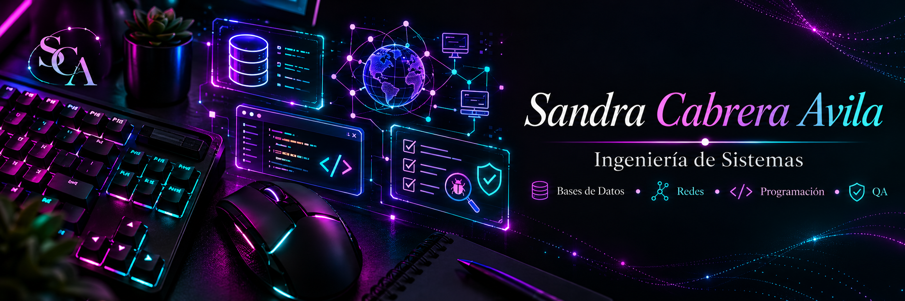

<!-- ====================================================== -->
<!--                 SANDRA CABRERA AVILA                   -->
<!--                  GITHUB PROFILE README                 -->
<!-- ====================================================== -->

 

 

Estudiante de **Ingeniería de Sistemas** enfocada en seguir creciendo en  
**desarrollo, bases de datos, redes y calidad de software**.

  

&nbsp;

&nbsp;

&nbsp;

---

## 👩‍💻 Sobre mí

Soy **Sandra Cabrera Avila**, estudiante de **Ingeniería de Sistemas** en la  
**Universidad César Vallejo**, actualmente cursando el **10.º ciclo**.

Me interesa desarrollarme en distintas áreas de la tecnología, especialmente en:

- **Desarrollo de software**
- **Bases de datos y análisis de información**
- **Redes y ciberseguridad**
- **QA y mejora de la calidad del software**

Busco seguir fortaleciendo mis habilidades mediante proyectos, formación especializada y experiencia práctica que me permita aportar valor en soluciones tecnológicas reales.

---

## ✨ Áreas principales

<table>
<tr>

<td align="center" width="220">
<h3>💻 Desarrollo</h3>
Aplicaciones web y móviles 
Arquitectura y lógica de software
</td>

<td align="center" width="220">
<h3>🗄️ Bases de Datos</h3>
SQL · ETL · Data Warehouse 
Modelamiento y análisis
</td>

<td align="center" width="220">
<h3>🌐 Redes</h3>
Switching · Routing 
Seguridad e infraestructura
</td>

<td align="center" width="220">
<h3>🧪 QA</h3>
Pruebas · Validación 
Calidad y mejora continua
</td>

</tr>
</table>

 

---

# 🛠️ Tech Stack

## 💻 Desarrollo

<table>
<tr>

<td align="center" width="95">

 <b>HTML5</b>
</td>

<td align="center" width="95">

 <b>CSS3</b>
</td>

<td align="center" width="95">

 <b>JavaScript</b>
</td>

<td align="center" width="95">

 <b>PHP</b>
</td>

<td align="center" width="95">

 <b>Java</b>
</td>

<td align="center" width="95">

 <b>C#</b>
</td>

<td align="center" width="95">

 <b>Python</b>
</td>

<td align="center" width="95">

 <b>React</b>
</td>

<td align="center" width="95">

 <b>Flutter</b>
</td>

<td align="center" width="95">

 <b>WordPress</b>
</td>

</tr>
</table>

---

## 🗄️ Bases de Datos, BI y Datos

<table>
<tr>

<td align="center" width="110">

 <b>SQL Server</b>
</td>

<td align="center" width="110">

 <b>MySQL</b>
</td>

<td align="center" width="110">

 <b>SQLite</b>
</td>

<td align="center" width="110">

 <b>Firebase</b>
</td>

<td align="center" width="110">

 <b>Power BI</b>
</td>

<td align="center" width="110">

 <b>Excel</b>
</td>

</tr>
</table>

 

`ETL` • `Data Warehouse` • `OLAP` • `Modelamiento de Datos`

---

## 🌐 Redes e Infraestructura

<table>
<tr>

<td align="center" width="120">

 <b>Cisco</b>
</td>

<td align="center" width="120">

 <b>Linux</b>
</td>

<td align="center" width="120">

 <b>Windows Server</b>
</td>

<td align="center" width="120">

 <b>VirtualBox</b>
</td>

</tr>
</table>

 

`Networking` • `Switching` • `Routing` • `Ciberseguridad`

---

## 🧪 QA, Gestión y Documentación

<table>
<tr>

<td align="center" width="110">

 <b>Git</b>
</td>

<td align="center" width="110">

 <b>GitHub</b>
</td>

<td align="center" width="110">

 <b>Jira</b>
</td>

<td align="center" width="110">

 <b>Figma</b>
</td>

<td align="center" width="110">

 <b>Visio</b>
</td>

</tr>
</table>

 

`QA` • `Pruebas de Software` • `Scrum` • `UML`

---

## 🎮 Otras herramientas

<table>
<tr>

<td align="center" width="120">

 <b>Unity</b>
</td>

<td align="center" width="120">

 <b>Blender</b>
</td>

<td align="center" width="120">

 <b>Cinema 4D</b>
</td>

<td align="center" width="120">

 <b>VirtualBox</b>
</td>

</tr>
</table>

---

# 🚀 Proyectos destacados

Aquí se muestran algunos proyectos que representan mejor mi formación y las áreas en las que vengo desarrollándome.

---

## 📱 Aplicación móvil para gestión de ventas y pedidos

### Bodega Librería Bazar Estelita

Aplicación móvil desarrollada para optimizar la gestión de ventas, pedidos e inventario de una bodega-librería.

**Principales funcionalidades**

- Autenticación y control de acceso por roles.
- Catálogo de productos.
- Carrito de compras.
- Gestión de inventario.
- Registro e historial de ventas.
- Firebase Authentication y Firestore.
- Arquitectura MVVM.

🔗 **[Ver repositorio](URL_REPO_1)**

---

## 📊 Sistema de Business Intelligence para gestión de ventas

### Farmacia

Proyecto orientado a transformar datos operativos en información útil para la toma de decisiones.

**Implementación**

- Base de datos OLTP.
- Data Warehouse.
- Modelamiento dimensional.
- Procesos ETL mediante SSIS.
- Cubos OLAP.
- Reportes mediante SSRS.
- Dashboards interactivos con Power BI.

🔗 **[Ver repositorio](URL_REPO_2)**

---

## 🦷 Sistema web para clínica odontológica

Sistema web desarrollado para automatizar diferentes procesos administrativos y clínicos.

**Principales funcionalidades**

- Autenticación y control de acceso.
- Gestión de pacientes.
- Gestión de doctores.
- Tratamientos y citas médicas.
- Gestión de pagos.
- Generación de reportes.
- Exportación a PDF y Excel.
- Arquitectura MVC.
- Patrón DAO para acceso a datos.

🔗 **[Ver repositorio](URL_REPO_3)**

---

## 🛒 Sistema web para gestión de ventas e inventario

### Librería Celi's

Sistema web desarrollado para organizar y automatizar procesos comerciales de una librería.

**Principales funcionalidades**

- Gestión de productos.
- Administración de usuarios.
- Registro de ventas.
- Control de inventario.
- Historial de transacciones.
- Base de datos relacional en MySQL.
- Arquitectura MVC.

🔗 **[Ver repositorio](URL_REPO_4)**

---

<b>🎮 Ver proyecto adicional — Simulación 3D</b>

 

### Remodelación de un parque de diversiones

Proyecto académico orientado a representar una propuesta de remodelación mediante una simulación tridimensional interactiva.

- Modelado de estructuras.
- Construcción de escenarios.
- Personaje controlable.
- Cámaras dinámicas.
- Exploración interactiva.
- Consideraciones de accesibilidad.

🔗 **[Ver repositorio](URL_REPO_5)**

---

# 💼 Experiencia

## 💻 Practicante de Desarrollo Web

**Grupo Consigueventas Inversiones E.I.R.L.**  
_Lima, Perú · Febrero 2026 – Junio 2026_

- Maquetación de páginas web en WordPress.
- Implementación de interfaces a partir de diseños en Figma.
- Uso de HTML y CSS.
- Adaptación responsive para desktop y móvil.
- Optimización de contenido e imágenes.
- Participación en capacitaciones técnicas.
- Seguimiento de proyectos y coordinación con el equipo.

---

## 🖥️ Apoyo independiente a profesional de sistemas

**Melliz Tec S.A.C.**  
_Lima, Perú · Marzo 2026 – Actualidad_

- Elaboración de informes técnicos.
- Redacción y gestión de correos profesionales.
- Organización de información y documentación digital.
- Apoyo en actividades relacionadas con desarrollo de sistemas.
- Coordinación y seguimiento de tareas y requerimientos.

---

# 🎓 Formación académica

### Ingeniería de Sistemas

**Universidad César Vallejo — UCV**

📅 2022 – Actualidad  
🎓 10.º ciclo

 

### Inglés B1

**Centro de Idiomas — Universidad César Vallejo**

📅 Febrero 2025

---

# 🏅 Certificaciones

<b>🌐 Cisco Networking Academy</b>

 

- **CyberOps Associate** — 2026
- **Operating Systems Basics** — 2026
- **CCNA: Redes Empresariales, Seguridad y Automatización** — 2025
- **CCNA: Fundamentos de Conmutación, Enrutamiento y Redes Inalámbricas** — 2025
- **Introducción a la Ciencia de Datos** — 2025
- **Introducción a la Ciberseguridad** — 2025

 

<b>🎓 Universidad Nacional de Ingeniería — CTIC UNI</b>

 

- **ERP Odoo Funcional y Técnico + IA** — 2026
- **UML (Lenguaje Unificado de Modelado)** — 2026
- **Modelamiento de Datos + IA** — 2026
- **Programación en Python — Nivel Intermedio** — 2025
- **Power BI — Nivel Intermedio** — 2025
- **Fundamentos de Programación con R** — 2025
- **SQL — Base de Datos II** — 2025
- **Fundamentos de Gestión de Proyectos Ágiles (Scrum)** — 2025

---

# 📈 GitHub Stats

  

  

---

# 🌱 Actualmente

Sigo fortaleciendo mis conocimientos en

### **Desarrollo · Bases de Datos · Redes · QA**

mientras continúo construyendo proyectos que me permitan aplicar lo aprendido  
en contextos cada vez más cercanos al entorno profesional.

 

### ✦ Aprender · Construir · Mejorar ✦

 

&nbsp;

&nbsp;

&nbsp;

  

Gracias por visitar mi perfil ✦

<!--
ACTIVA ESTE CONTADOR CUANDO TENGAS TU USUARIO REAL DE GITHUB:

-->

